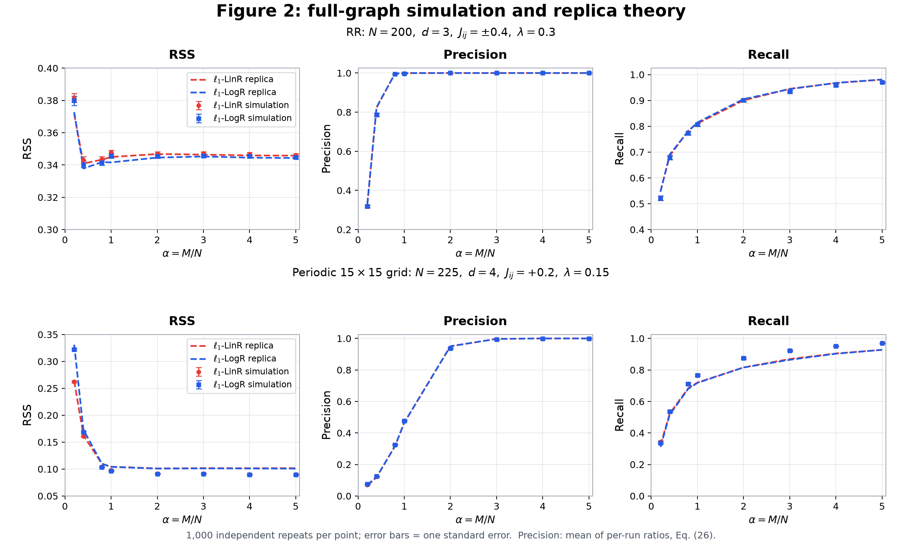

# Ising Model Selection: Replica Theory and Numerical Experiments

[中文说明](README.zh-CN.md) · [Paper](https://proceedings.neurips.cc/paper_files/paper/2021/file/31917677a66c6eddd3ab1f68b0679e2f-Paper.pdf) · [Supplement](https://proceedings.neurips.cc/paper_files/paper/2021/file/31917677a66c6eddd3ab1f68b0679e2f-Supplemental.pdf) · [MIT license](LICENSE)

Code accompanying **Ising Model Selection Using ℓ₁-Regularized Linear Regression: A Statistical Mechanics Analysis**, Xiangming Meng, Tomoyuki Obuchi, and Yoshiyuki Kabashima, NeurIPS 2021.

This repository reproduces **Figure 2**: finite-size replica predictions and full-graph Ising simulations for ℓ₁-regularized linear and logistic regression. It is a **2026 reimplementation from the paper**, not the original 2021 code or recovered original numerical outputs. Other figures are outside the current scope.



Dashed lines: replica predictions. Markers: new simulations, 1,000 independent repetitions per point. Error bars: one standard error. Precision is averaged over per-run ratios, following Eq. (26).

## What is included

| Graph | N | Degree | Couplings | λ |
|---|---:|---:|---|---:|
| Random regular (RR) | 200 | 3 | Independent ±0.4 on each edge | 0.3 |
| Periodic 15×15 grid | 225 | 4 | +0.2 on every edge | 0.15 |

Both estimators use α = M/N ∈ {0.2, 0.4, 0.8, 1, 2, 3, 4, 5}. The bundled reference results contain 32 theory points and **32,000 full-dimensional fits**, plus 2,048 fits for a thinning-sensitivity audit. Coefficients and graphs are included for every experimental repeat.

The grid simulation uses the actual periodic grid. Its replica prediction uses the paper's tree approximation, including the d=4 RR spectral formula. The visible grid theory–experiment discrepancy is retained. Some points differ from the published figure; no digitized coordinates were used to fit the numerical results.

## Install

Use Python **3.11 or newer**, NumPy, SciPy, Matplotlib, and Pillow. A **C++17 compiler** callable as `c++` is required for calculations and numerical tests. Native libraries compile automatically on first use. The build targets macOS and Linux; use WSL on Windows.

From the repository directory:

```bash
python3 -m venv .venv
source .venv/bin/activate
python -m pip install -r requirements.txt
```

For the versions used in the reference calculation, use `requirements-reference.txt` with Python 3.13.7. These pins record that environment; they are not a promise of identical output across compilers and platforms. Plotting the bundled results needs no compiler or network access after dependencies are installed.

## Start with the saved results

```bash
python reproduce.py plot
```

This reads `data/reference/` and writes PNG/SVG figures to `outputs/figures/`. **Reference files are never overwritten by the public workflow.** No paper PDF needs to be downloaded.

```bash
python reproduce.py check
python reproduce.py verify-reference
```

`check` runs 14 scientific tests and 4 release/interface tests. `verify-reference` checks file hashes, then audits all 2,128 experimental checkpoints and reconstructs their metrics from the stored coefficients. Reports are written to `outputs/validation/`.

The [local release audit](docs/release-validation.json) records checks performed after extracting a clean source archive and recompiling the native kernels. The GitHub Actions matrix is configured separately and will run when the repository is pushed.

## Run new calculations

| Command | What it computes |
|---|---|
| `python reproduce.py theory` | All 32 replica points; plots against saved experiments |
| `python reproduce.py experiments` | 1,000 new repeats per point; plots against saved theory |
| `python reproduce.py all` | Both theory and experiments from fresh calculations |
| `python reproduce.py all --quick` | Reduced-size smoke calculation for the whole workflow |

Normal calculations write to `outputs/`; `--quick` writes to `outputs/quick/`. Set another destination with `--output PATH`. Experimental runs resume completed checkpoints; theory runs recompute the requested points. Use a new output directory when changing configuration or numerical source code.

**Quick mode is only a smoke test:** 2,000/500 local theory samples, three experimental repeats per point, and 1,000 MCS burn-in. It is not suitable for scientific comparisons. Full theory uses 30,000 LinR / 8,000 LogR local Monte Carlo samples. Full simulation uses 100,000 MCS burn-in. Runtime depends on the machine; plotting saved data is much faster than running the full calculation.

More control is available through the individual scripts:

```bash
python run_figure2.py --settings rr --losses lin --alphas 0.4 1 5 --out outputs/theory-subset
python run_experiments.py --repeats 1000 --workers 4 --out outputs/experiments-custom
python plot_experiments.py --theory outputs/theory --experiments outputs/experiments --out outputs/new-figures
```

`plot_experiments.py` requires all 32 points and equal repeat counts. Reduced-repeat results are labeled as previews. Use `python SCRIPT.py --help` for options.

The additional audits are separate from `all`:

```bash
python run_experiments.py --repeats 64 --gap 20 --out outputs/diagnostics/thinning20
python audit_sampling.py --experiments outputs/experiments --out outputs/diagnostics
python validate_experiments.py --experiments outputs/experiments --diagnostics outputs/diagnostics --theory outputs/theory --out outputs/validation-new
```

The full checkpoint audit expects the documented 1,000/64-repeat configurations and seed 20260915. For custom seeds or reduced runs, use the numerical tests and inspect the per-fit KKT/summary records instead.

## Scientific conventions and limitations

- **Actual full-dimensional objectives:** squared loss is scaled by 1/(2M); logistic loss is `mean(log(1 + exp(-2*y*XJ)))`. Both add λ‖J‖₁. No intercept, centering, or standardization is used.
- **Sampling:** random-site Metropolis, 100,000 MCS burn-in, snapshots every 5 MCS, and a pool of 5× the largest M. Each point uses a random subset without replacement. The gap and pool-sharing details are explicit reconstruction choices; see [sampling protocol](docs/experiments.md).
- **Independence:** repetitions within a point use independent random streams. Different α values share the graph and pool within a repetition; LinR/LogR use paired data. MCMC draws are approximately, not exactly, independent.
- **Precision:** the primary figure uses `mean(TP/(TP+FP))`. An alternative figure uses `mean(TP)/(mean(TP)+mean(FP))` for both theory and experiment. These differ at finite N; neither is silently substituted for the other. Empty predictions have precision 1 and are separately counted.
- **Equation discrepancies:** the H updates printed in Algorithms 2/3 differ from the formal EOS. This implementation follows main-text Eq. (19) / supplementary Eq. (67), as detailed in [theory notes](docs/theory.md).
- **Optimization:** every reference fit satisfies a global KKT tolerance of 2×10⁻¹⁰. This measures optimization accuracy, not agreement with the original plot. The stored results also include MCMC and support-threshold diagnostics.

See [theory](docs/theory.md), [experiments](docs/experiments.md), and the [data dictionary](docs/data.md) for equations, assumptions, seeds, and interpretation of error bars.

## Repository layout

```text
replica.py, logistic.cpp             Replica EOS and local surrogate estimators
experiments.py, experiment_native.cpp Full Ising graphs, MCMC and N−1 regressions
run_figure2.py, run_experiments.py    Numerical drivers
reproduce.py                        Public workflow
plot_*.py                           Figures from saved or new results
test_*.py                           Scientific and interface tests
audit_sampling.py                   Initialization/autocorrelation audit
validate_experiments.py              Complete checkpoint audit
data/reference/                     Immutable reference arrays and metadata
docs/                               Theory, protocol, data and publishing notes
tools/                              Reference checks and release packaging
.github/workflows/tests.yml         Linux/macOS CI configuration
outputs/                            New local calculations (gitignored)
```

The repository is intentionally runnable directly from a clone; no package installation or GPU is needed. C++ dynamic libraries, virtual environments, and generated output directories are excluded from version control.

## Citation

Please cite the paper when using this code or its results. GitHub's “Cite this repository” uses [CITATION.cff](CITATION.cff); a [BibTeX entry](CITATION.bib) is also included.

```bibtex
@inproceedings{meng2021ising,
  title = {Ising Model Selection Using $\ell_1$-Regularized Linear Regression: A Statistical Mechanics Analysis},
  author = {Meng, Xiangming and Obuchi, Tomoyuki and Kabashima, Yoshiyuki},
  booktitle = {Advances in Neural Information Processing Systems},
  volume = {34},
  year = {2021}
}
```

## License and contributions

Released under the [MIT License](LICENSE). See [CONTRIBUTING.md](CONTRIBUTING.md) for validation expectations and [publishing notes](docs/publishing.md) for creating the GitHub repository. The paper is linked, not redistributed in this code repository.
