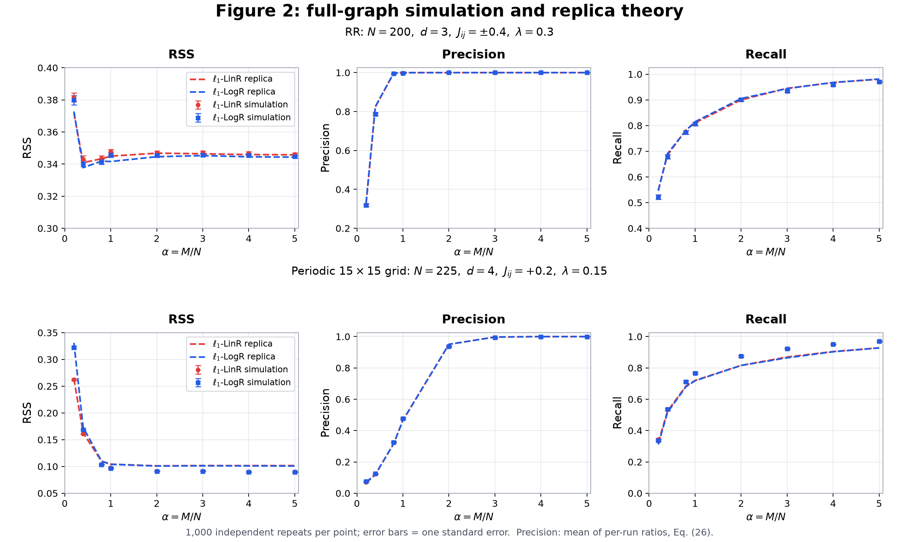

# Ising 模型选择：论文开源代码

[English README](README.md) · [论文](https://proceedings.neurips.cc/paper_files/paper/2021/file/31917677a66c6eddd3ab1f68b0679e2f-Paper.pdf) · [MIT 许可证](LICENSE)

对应 Meng、Obuchi 和 Kabashima 的 NeurIPS 2021 论文 *Ising Model Selection Using ℓ₁-Regularized Linear Regression: A Statistical Mechanics Analysis*。

本仓库是 **2026 年依据论文重新实现**的代码，覆盖图 2 的 replica 理论和数值实验，并非遗失的 2021 年原代码。RR 与周期网格、LinR 与 LogR、8 个 α，共 32 个参数点；保存了每点 1,000 次重复，总计 32,000 次全维拟合，以及全部图结构和回归系数。



## 安装与运行

Python ≥3.11；数值计算和测试需要可调用的 C++17 编译器 `c++`。支持的构建目标为 macOS/Linux，Windows 可使用 WSL。仅从现有数据绘图不需要编译器。

```bash
python3 -m venv .venv
source .venv/bin/activate
python -m pip install -r requirements.txt
python reproduce.py plot
```

新图片保存在 `outputs/figures/`。`data/reference/` 是已经完成并验证的参考数据，公开运行入口不会覆盖它。

```bash
python reproduce.py check             # 14 项科学测试 + 4 项接口/交付测试
python reproduce.py verify-reference  # 校验哈希及全部实验 checkpoint
python reproduce.py all --quick       # 小规模试跑，不作为科学结果
python reproduce.py theory            # 重新计算全部 replica 理论点
python reproduce.py experiments       # 重新进行每点 1,000 次实验
python reproduce.py all               # 两部分都重新计算
```

正常计算写入 `outputs/`，快速试跑写入 `outputs/quick/`；可用 `--output PATH` 指定其他目录。实验支持断点恢复；理论驱动重新计算所请求的点。参数或数值源码变更后，实验会拒绝混用旧 checkpoint。

MIT 许可证、英文文档、GitHub Actions、引用文件和维护说明均已包含。发布步骤见 [publishing.md](docs/publishing.md)。这里只准备仓库内容，不包含 GitHub 账号信息或远程地址。

## 结果的解释

真实实验使用完整 RR 图或 15×15 周期网格进行 Metropolis 采样，并求解 N−1 维回归。网格的 replica 理论仍使用树近似，因此实验与理论之间的系统性差异被保留。

主图 Precision 是逐次计算 TP/(TP+FP) 后取平均；另附“均值之比”版本，两种定义明确区分。所有主实验拟合的全局 KKT 残差均不超过 2×10⁻¹⁰，但这个数衡量优化精度，不是与原图的差异。

每个点内的重复相互独立，不同 α 在同一个重复中共享图和样本池；MCMC 样本只近似独立。采样间隔、种子等未完整记载于原论文的细节，均作为本次实现选择注明。理论算法框中的 H 更新与正式 EOS 有不一致处，本实现采用正式 EOS。

详细说明：[理论方程](docs/theory.md)、[实验协议](docs/experiments.md)、[数据字典](docs/data.md)。使用代码或数据时请引用论文，引用信息见 [CITATION.cff](CITATION.cff) 和 [CITATION.bib](CITATION.bib)。
